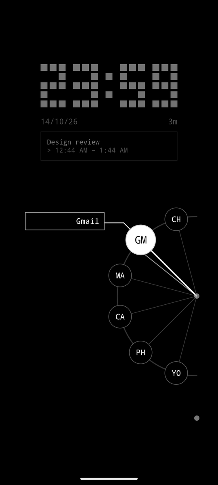
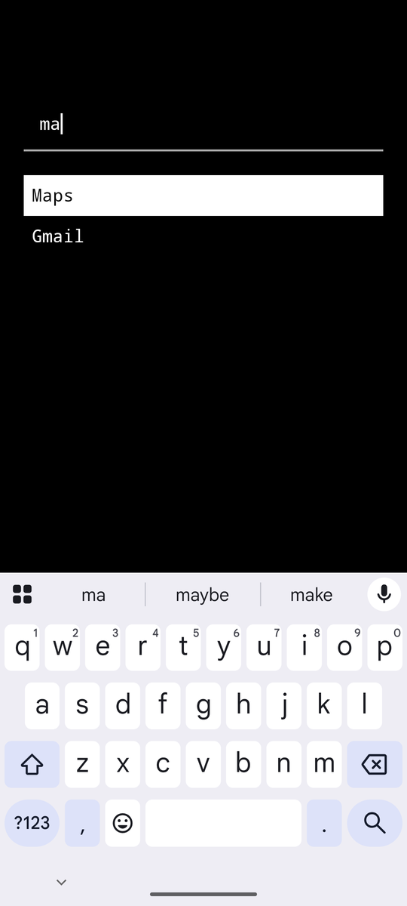
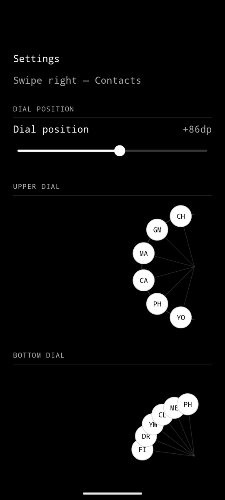

# Focus Launcher

A black-and-white Android launcher with no icons. Just a clock, your next event, and two
dials for the apps you actually use.

<p align="center">
  
  
  
  
</p>

- **Dials** — drag from a dot on the right, rotate to an app, let go.
- **Search** — swipe up and type; it opens as soon as only one app matches.
- **Swipes** — left for camera, right for contacts, down for notifications.
- **Settings** — long-press the clock to set up dials and gestures.
- No internet permission, no accounts.

## Install

1. Download `FocusLauncher.apk` from [Releases](https://github.com/AbinavPallathoor/Focus-Launcher/releases/latest) on your phone and open it.
2. If asked, allow installs from your browser. If Play Protect warns you, tap **More details → Install anyway**.
3. Press Home and choose **Focus Launcher → Always**.

To switch back: Settings → Apps → Default apps → Home app.

## Build

```sh
gradle assembleRelease
```
